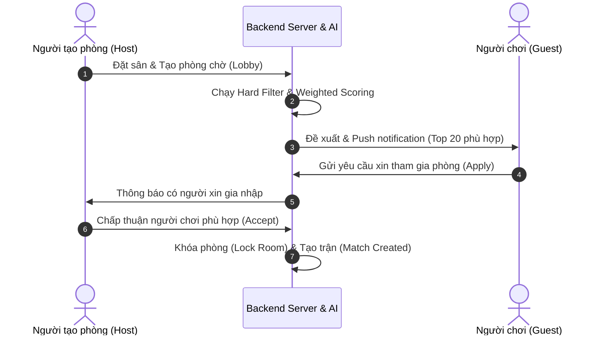

# Kế Hoạch Thiết Kế & Triển Khai: Hệ Thống Ghép Trận Nâng Cao (MVP + AI-Ready Architecture)

Dự án này thực hiện tái cấu trúc toàn diện cơ chế ghép trận của ứng dụng đặt sân sang mô hình **Ghép trận Thực tế Thực chiến (Real-World Matchmaking)**. Hệ thống được thiết kế để rà soát theo khía cạnh **"hệ thống có chạy được ngoài đời không"**, phòng tránh các vấn đề bùng kèo, khai khống trình độ, người mới bị chìm, hành vi toxic và chuẩn bị cơ sở dữ liệu để AI tự học về sau.

---

## Kiến Trúc Tổng Thể

```text
User Profile
      ↓
Hard Filter (Loại bỏ nhanh)
      ↓
Weighted Scoring (Thang điểm MVP)
      ↓
Re-ranking Layer (Cân bằng & Chống spam)
      ↓
Double Opt-in (Sự đồng thuận 2 bên)
      ↓
Match Created
      ↓
Post-match Feedback (Thu thập dữ liệu ẩn)
      ↓
AI Learning (Tự học & Đề xuất)
```

---

## 1. Thu Thập Dữ Liệu Người Dùng (AI-Ready Profile)

### Hồ sơ kỹ năng và sở thích cơ bản (User Profile)
```json
{
  "sport": "badminton",
  "skill": 7,                  // Thang điểm trình độ tự chọn 1 - 10
  "location": "District7",
  "availableTime": ["19:00-21:00"],
  "playStyle": "competitive", // competitive | casual
  "frequency": "3/week"
}
```

### Chỉ số hành vi hệ thống tự học (User Behavior & Reliability)
```json
{
  "attendanceRate": 0.95,      // Tỷ lệ có mặt thực tế
  "cancelRate": 0.02,          // Tỷ lệ hủy kèo
  "avgResponseTime": "3min",   // Thời gian phản hồi trung bình khi nhận lời mời
  "repeatedMatches": 8,        // Số trận tái đấu với cùng đối thủ
  "rating": 4.8                // Đánh giá trung bình từ cộng đồng
}
```

---

## 2. Lớp Lọc Nhanh (Hard Filter)

Lớp lọc đầu tiên giúp giảm tải cho server bằng cách loại bỏ nhanh những người chơi không tương thích qua câu lệnh Query trực tiếp trong Database:

| Tiêu chí | Điều kiện lọc bắt buộc |
| :--- | :--- |
| **Môn thể thao** | Phải giống nhau hoàn toàn |
| **Khu vực** | Nằm trong bán kính $X\text{ km}$ tối đa |
| **Khung giờ** | Có thời gian giao nhau (Overlap) $\ge 30$ phút |
| **Slot còn thiếu** | Phù hợp với số lượng vị trí còn trống trong phòng |
| **Giới tính** *(nếu bật)* | Phải khớp với yêu cầu của phòng |
| **Độ tuổi** *(nếu bật)* | Phải nằm trong khoảng yêu cầu |

---

## 3. Chấm Điểm Trọng Số (Weighted Scoring MVP)

Các đối thủ vượt qua Hard Filter sẽ được chấm điểm tương thích với thang điểm tổng tối đa là **1.0**:

$$\text{TotalScore} = 0.30 \times \text{SkillMatch} + 0.25 \times \text{DistanceScore} + 0.20 \times \text{TimeOverlap} + 0.15 \times \text{Reliability} + 0.10 \times \text{PlayStyle}$$

### Chi tiết cách tính các chỉ số thành phần:

#### A. Trình độ (`SkillMatch`) — Trọng số 30%
Tránh tuyệt đối việc lệch trình độ quá xa gây trải nghiệm tệ.
$$\text{SkillMatch} = 1 - \frac{|\text{userA.skill} - \text{userB.skill}|}{\text{maxDifference}}$$
*Ví dụ: User A trình độ 7, User B trình độ 6 (lệch 1 trên thang 10) $\rightarrow \text{SkillMatch} = 1 - 1/10 = 0.9$.*

#### B. Khoảng cách (`DistanceScore`) — Trọng số 25%
Khoảng cách được chấm điểm theo dạng **bậc thang (step-wise)** vì người chơi thể thao phong trào rất dễ bỏ kèo nếu phải di chuyển quá xa:
* Khoảng cách $< 2\text{ km}$: **`1.0`** điểm
* Khoảng cách $< 5\text{ km}$: **`0.8`** điểm
* Khoảng cách $< 10\text{ km}$: **`0.5`** điểm
* Khoảng cách $\ge 10\text{ km}$: **`0.0`** điểm

#### C. Độ uy tín (`Reliability`) — Trọng số 15%
Giải quyết vấn đề nhức nhối nhất là "Bùng Kèo" dựa trên dữ liệu chuyên cần:
$$\text{Reliability} = 0.5 \times \text{AttendanceRate} + 0.3 \times \text{Rating} + 0.2 \times \text{NoShowPenalty}$$

---

## 4. Lớp Sắp Xếp Lại (Re-ranking Layer)

Lớp này giải quyết vấn đề mất cân bằng hệ thống (người cũ điểm cao chiếm sóng, người mới bị cô lập):

$$\text{FinalScore} = \text{TotalScore} + \text{NewUserBoost} + \text{DiversityBoost} - \text{SpamPenalty}$$

* **`NewUserBoost` (+0.05):** Cộng điểm ưu tiên hiển thị cho người chơi mới đăng ký dưới 3 trận đấu để tăng cơ hội tìm trận (Tránh Cold-Start).
* **`DiversityBoost` (+0.03):** Ưu tiên ghép với những đối thủ mới thay vì đề xuất trùng lặp những người đã chơi cùng quá 5 lần.
* **`SpamPenalty` (-0.10):** Trừ điểm đối với những người gửi yêu cầu ứng tuyển hàng loạt, liên tục đến nhiều phòng trong thời gian ngắn.

---

## 5. Quy Trình Double Opt-in (Xác Nhận 2 Chiều)

Tuyệt đối không tự động gom người cưỡng ép. Chỉ tạo trận khi cả hai bên tự nguyện đồng ý.



---

## 6. Hệ Thống Thu Thập Dữ Liệu Cho AI (AI-Ready Data Schema)

Hệ thống lưu giữ lịch sử và hành vi chi tiết ngay từ ngày đầu làm cơ sở dữ liệu huấn luyện AI:

### Bảng Lịch Sử Trận Đấu (`match_history`)
Lưu giữ chi tiết kết quả, độ lệch trình độ và tỷ lệ hủy trận thực tế:
```sql
CREATE TABLE match_history (
    match_id VARCHAR(50) PRIMARY KEY,
    user_id VARCHAR(50) REFERENCES users(id),
    sport VARCHAR(30) NOT NULL,
    scheduled_time TIMESTAMP NOT NULL,
    location VARCHAR(100) NOT NULL,
    skill_level INT NOT NULL,
    joined BOOLEAN DEFAULT TRUE,
    completed BOOLEAN NOT NULL,
    rating FLOAT CHECK (rating >= 1 AND rating <= 5),
    cancelled BOOLEAN DEFAULT FALSE,
    partner_ids VARCHAR[] -- Mảng ID của những người cùng chơi
);
```

### Bảng Hành Vi Người Dùng (`user_behavior`)
Lưu thói quen tương tác và độ tin cậy thực tế:
```sql
CREATE TABLE user_behavior (
    user_id VARCHAR(50) REFERENCES users(id) PRIMARY KEY,
    avg_accept_time INT,           -- Thời gian phản hồi đồng ý trung bình (giây)
    cancel_rate FLOAT DEFAULT 0.0, -- Tỷ lệ hủy kèo
    weekly_frequency FLOAT,        -- Tần suất chơi trung bình hàng tuần
    preferred_play_time JSONB      -- Khung giờ ưa thích nhất (JSON: { "Monday": "19:00-21:00" })
);
```

---

## 7. Lộ Trình Tiến Hóa AI Thực Tế

* **Giai đoạn 1 (0 – 5k Users) - Rule-based Engine:**
  * Chạy trên cơ chế **Hard Filter + Weighted Scoring** tĩnh (sử dụng MongoDB Query và phép tính toán học cơ bản trên Node.js).
* **Giai đoạn 2 (5k – 50k Users) - Vector & Cosine Similarity:**
  * Biến đổi hồ sơ người dùng thành Vector 6 chiều: `[skill, district_code, frequency, preferred_day, preferred_time, rating]`.
  * Sử dụng thuật toán Cosine Similarity để tìm kiếm những láng giềng gần nhất (Nearest Neighbors) có mức độ tương đồng sở thích cao nhất.
* **Giai đoạn 3 (> 50k Users) - Collaborative Filtering:**
  * Hệ thống tự học thói quen xã hội của người dùng: *Nếu A thích chơi với B, A thích chơi với C, và hành vi của B tương tự D $\rightarrow$ Hệ thống tự động đề xuất D cho A* (Giống thuật toán của Netflix/Tinder).

---

## 💡 Tính Năng Tạo Sự Khác Biệt: "AI Auto Fill Match"

Một tính năng đột phá giúp giữ chân người dùng vượt trội:
> **"Bạn đặt sân cầu lông lúc 20:00 tối nay và còn thiếu 2 người chơi?"**

Chỉ với 1 nút bấm kích hoạt **Auto-Fill**, AI sẽ tự động thực hiện:
1. Quét tìm và tự động gửi lời mời trực tiếp đến nhóm người chơi phù hợp nhất quanh khu vực.
2. Tự động xác nhận và **khóa phòng (Lobby Lock)** khi có đủ người chấp nhận lời mời.
3. Tự động tạo nhóm chat trao đổi chung.
4. Tự động tính toán chia tiền sân (Split bill) qua Ví điện tử của app.
👉 **Trải nghiệm đích thực: Đặt sân $\rightarrow$ AI lo ghép người $\rightarrow$ Chỉ việc đến chơi!**

---

## Kế Hoạch Triển Khai MVP

Tôi đã thiết lập bảng phân công nhiệm vụ chi tiết tại **[task.md](file:///C:/Users/khoit/.gemini/antigravity-ide/brain/686aecd1-7629-4027-8f9d-b0e112088054/task.md)** để bắt đầu hiện thực hóa kiến trúc này:
1. **Giai đoạn 1:** Nâng cấp các Schema Database (`userModel.ts`, `userSkillModel.ts`) và tạo mới các Schema lưu trữ AI-ready (`lobbyModel.ts`, `matchHistoryModel.ts`, `userBehaviorModel.ts`).
2. **Giai đoạn 2:** Viết lại thuật toán tính điểm Weighted Scoring mới và bộ Re-ranking Layer phụ trợ tại `matchmakingWorker.ts`.
3. **Giai đoạn 3:** Xây dựng hệ thống API cho luồng Double Opt-in Lobby (`createLobby`, `apply`, `accept`).
4. **Giai đoạn 4:** Triển khai Blind Review đánh giá ẩn để bảo vệ người dùng và lấy dữ liệu huấn luyện AI sạch.
